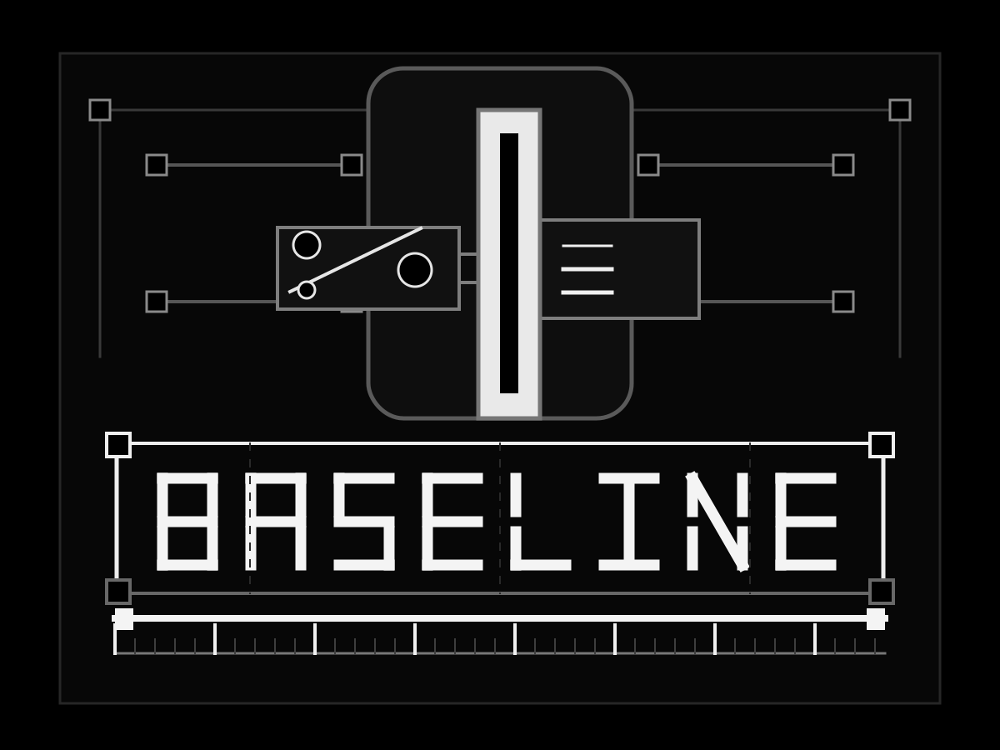

# baseline

<p align="center">
  
</p>

<p align="center">
  <a href="resources/logo.ans">ANSI logo</a> |
  <a href="resources/logo.txt">plain text logo</a>
</p>

A drift-correction system for AI coding agents — Claude Code, Codex, pi, oh-my-pi, and opencode. Over a long session the agent forgets standing rules (e.g. "route file operations through subagents, don't do them inline"). baseline periodically injects small, trusted text into the model's context at chosen hook events — most often a **recital**: every Nth user prompt the agent must open its reply with a fixed prefix line and restate the rules verbatim before continuing. Reciting both re-aligns the agent (generating the rule primes the next action) and exposes drift (you see in the recital whether it got the rules right).

Inspired by the Blade Runner 2049 baseline test.

## What it is

baseline generalizes "recite the rules every N prompts" into **user-configurable injection routes**. A route binds a trusted **doc** (the verbatim text to inject) to a hook **event**, on its own **frequency**, optionally scoped to a session phase or working directory. You can run the classic recital every 5 prompts, drop compact-resume instructions on session resume, or remind the agent before tool calls — each independently.

Two things are kept strictly separate:

- **Docs** (`docs/*.md`) hold *what* is injected — the exact text, verbatim. No wrapper is added by code, so any "open with this line, restate verbatim" scaffolding lives inside the doc.
- **`config.json`** holds *when/where* — routing only: which doc fires at which event, how often, and under what scope. It carries no injected text.

This package targets five agents sharing one route config and one dispatcher. Claude Code and Codex read a JSON hook config the manager edits surgically. pi, oh-my-pi, and opencode host in-process extensions instead, so the manager generates a small marker-tagged **shim** (a pi/omp extension or an opencode plugin) that spawns the same dispatcher and injects its output; pi/oh-my-pi extensions can deliver `UserPromptSubmit` + `SessionStart` routes, opencode delivers all four events. Runtime selection is shared: plain install/update wires the shipped Zig/native dispatcher as the default hook hot path when available; Node remains the lifecycle manager, fallback dispatcher, and explicit `--runtime node` path.

Canonical goal docs live under `.arca/baseline-sp/goal/`: `vision.md`, `architecture.md`, and `vocabulary.md`, with `plain.md` recording the current decision summary. They define stable external contracts as the CLI lifecycle, config schema, hook stdin/stdout protocol, and plugin manifests. Static docs are the current default; dynamic placeholder replacement is future opt-in.

## How it works

One small **dispatcher** runs on each wired hook event. It reads the event JSON the harness passes on stdin, loads `cfg/baseline/config.json`, selects the routes matching the `(event, cwd)`, bumps each route's own per-session counter, and on a route's Nth match prints a JSON object whose `additionalContext` field the agent injects into the model's context as a system reminder. The dispatcher carries **zero baked content**: if the config or docs are gone it injects nothing and exits clean, and `doctor` reports the fault.

Supported injecting events: `UserPromptSubmit`, `SessionStart` (optionally a lifecycle phase via the event form `SessionStart.<phase>`, e.g. `SessionStart.compact`), `PreToolUse` / `PostToolUse`.

## Requirements

- **Claude Code, Codex, pi, oh-my-pi, or opencode** — the agent harness
- **Node.js** — runs the installer/manager and the Node fallback/explicit dispatcher
- **Zero runtime dependencies** — the Node dispatcher and manager import only the Node standard library (enforced by a regression test); TypeScript is a dev-only build dependency.

**Platforms:** plain install/update wires the shipped Zig/native dispatcher as the default hook hot path when a prebuilt exists for the platform. A missing or undeployable prebuilt falls back to the Node dispatcher; `--runtime node` forces Node.

## Install

Run the installer for your platform:

**Windows (PowerShell):**
```powershell
.\install.ps1
```

**Linux / macOS (bash):**
```bash
bash install.sh
```

Both delegate to `node scripts/manage.js install`, which:
1. Deploys the Node dispatcher/contracts and, when selected or available, the shipped Zig/native hook binary to the **install root**, under `~/.baseline/hooks/`.
2. Establishes the **config folder** — your routes + docs (`config.json` + `docs/`). It lives wherever you point `BASELINE_CFG` (else `<install root>/cfg`); when `BASELINE_CFG` is set, `<install root>/cfg` is a symlink to it. If empty, it is seeded from a repo **preset** — `default` by plain install (`--preset minimal` for the neutral floor).
3. **Links** each agent's config dir back into the install root — the dispatcher plus `contracts.js` and its generated `generated-contract.js` dependency — with the native hook binary linked when active and each agent's `cfg/baseline/` → `<install root>/cfg` (your config folder).
4. Deploys the installed control-surface payload. Claude gets the skills-dir plugin as `baseline@skills-dir`; Codex gets a manager-owned local marketplace registered and installed through `codex plugin`. The manager does not edit Codex's private cache or plugin tables directly. Control-surface plugins carry **no hooks** — they only make baseline discoverable, not active.
5. Wires Claude Code `~/.claude/settings.json` and Codex `~/.codex/hooks.json` for **exactly** the events the config's routes use, and unwires events no route references. For pi (`~/.pi/agent/extensions/`), oh-my-pi (`~/.omp/agent/extensions/`), and opencode (`~/.config/opencode/plugins/baseline/` plus a `plugin` entry in `opencode.json`) it deploys the generated shim when the config has events that agent can deliver, and removes it when none remain.

When `status` reports a symlink, editing your config folder (`BASELINE_CFG`, else `<install root>/cfg`) changes live behavior for every wired agent at once. On Windows without symlink privilege the link layer degrades to a hardlink (dispatcher/contracts) or a plain copy (config folder and skill/plugin payloads); `status`/`doctor` report which mechanism is in effect, and a copy needs a reinstall/update after edits.

The **install root** (regenerable artifacts: dispatcher + skill payload) resolves as `BASELINE_HOME`, else the installed manager's own root, else `~/.baseline`. The **config folder** (your routes + docs) defaults to `<install root>/cfg`, or set `BASELINE_CFG` to keep it anywhere — e.g. a version-controlled dotfiles repo — in which case `<install root>/cfg` becomes a symlink to it. Config and artifacts never share a directory. Claude's config dir comes from `CLAUDE_CONFIG_DIR` or `~/.claude`; Codex's comes from `CODEX_HOME` or `~/.codex`; pi's from `BASELINE_PI_HOME` or `~/.pi/agent`; oh-my-pi's from `BASELINE_OMP_HOME` or `~/.omp/agent`; opencode's from `BASELINE_OPENCODE_HOME`, else `$XDG_CONFIG_HOME/opencode`, else `~/.config/opencode` (the `BASELINE_*` variables are manager-owned detection overrides — those agents define none of their own). After install, open `/hooks` in each agent once (or restart) so hook config reloads.

## The config folder (the everyday task)

Everything you tune lives in your config folder — `BASELINE_CFG` if set, else `<install root>/cfg`:

```text
<config folder>/   # BASELINE_CFG, else <install root>/cfg
  config.json     # routes: when/where/how-often/which doc
  docs/           # the verbatim text each route injects
    baseline.md
  README.md       # editing guidance (never injected — no route points at it)
```

This folder holds **only configuration** — no install artifacts. The dispatcher and skill payload live separately under the install root (`~/.baseline`), so you can keep this folder in a dotfiles repo and sync it across machines.

Edit a **doc** to change what is injected (takes effect on the next firing — no reinstall). Edit **`config.json`** to add a route, change a route's `event`/`freq`/`cwd`, or point it at a different doc. After changing the *set of events* your routes use, rerun `install`/`update` so hook wiring stays in sync.

A route is one entry in `config.json` `routes[]`:

```json
{
  "version": 1,
  "routes": [
    { "id": "baseline", "event": "UserPromptSubmit", "freq": 5, "doc": "docs/baseline.md" }
  ]
}
```

- `id` — required, unique, slug-shaped (`^[a-z0-9][a-z0-9-]*$`). Keys the route's counter.
- `event` — required, one of `UserPromptSubmit`, `SessionStart`, `PreToolUse`, `PostToolUse`, and the sole resolver of *when* a route fires. To target a session phase, suffix the event — `SessionStart.startup` / `SessionStart.compact` / `SessionStart.clear` (`SessionStart.resume` is accepted but currently unused).
- `doc` — required, path relative to the config folder; must stay inside it.
- `freq` — optional positive integer, default `1`. Fires when `count % freq == 0`.
- `cwd` — optional path prefix. Fires only when the session working directory is at or under it.

Docs are static in schema v1. Their contents are injected byte-for-byte; text that
looks like a placeholder, such as `{{event}}`, remains literal text. Dynamic
replacement is reserved for a future explicit opt-in contract.

Docs must be valid UTF-8. If any due doc is malformed, the dispatcher fails open:
it emits no hook output and exits successfully. To troubleshoot a silent no-op, set
`BASELINE_DIAGNOSTICS=1`; the dispatcher then writes only a stable, redacted reason
code to stderr. Diagnostics never include doc text, session ids, counter contents,
or absolute paths, and never change stdout or the exit status.

To add a new injection, copy a pair from `assets/route-templates/` (a doc + its matching route) or ask the plugin to author one. See the `README.md` in your config folder for the runtime caps.

### Presets

`install` deploys exactly one preset into the config folder if none exists:

- `presets/default/` — the curated baseline (multi-route). Applied by a plain `install`.
- `presets/minimal/` — the neutral floor: one `baseline` / `UserPromptSubmit` / `freq 5` route with project-agnostic guardrails. Opt-in: `install --preset minimal`.

`install` never overwrites an existing config folder without `--force` (which replaces it wholesale — your edits are lost).

## Managing baseline

| Command | Description |
|---------|-------------|
| `status` | Shows the install root, config folder (and whether it's external), dispatcher sync, every route, and per-agent per-event wiring + link health. |
| `install [--preset <n>] [--force] [--runtime <node|prebuilt|build>]` | Deploys dispatcher artifacts, seeds the config preset, links each agent, wires hook config for the config's events. Defaults to the shipped Zig/native prebuilt when available; `--runtime node` forces Node. Idempotent. |
| `verify` | Functional test: drives the wired dispatcher and confirms a route fires with `additionalContext`. |
| `update [--runtime <node|prebuilt|build>]` | Redeploys dispatcher artifacts and re-syncs hook wiring from the current config (keeps the config folder). Defaults to the shipped Zig/native prebuilt when available; `--runtime node` forces Node. |
| `doctor` | Validates `config.json` + every route + per-event wiring; reports OK/WARN/FAIL and exits nonzero on any fault. `--fix` repairs and re-scans. |
| `uninstall` | Unwires baseline across all events and removes per-agent links. Preserves the config folder. |

```bash
node scripts/manage.js status
node scripts/manage.js install            # seeds default; --preset minimal for the neutral floor
node scripts/manage.js install --runtime node  # force the Node dispatcher hot path
node scripts/manage.js verify
node scripts/manage.js update
node scripts/manage.js doctor             # add --fix to repair
node scripts/manage.js uninstall
```

Or via the platform wrappers:
```bash
bash update.sh        # pulls latest if a git checkout, then redeploys
bash doctor.sh --fix  # scan + repair
bash uninstall.sh
```
```powershell
.\update.ps1
.\doctor.ps1 -fix
.\uninstall.ps1
```

All commands are idempotent and preserve any co-resident hooks (e.g. other skills). Hook-config edits are surgical. `install`/`uninstall` refuse to rewrite malformed `settings.json`/`hooks.json`; fix the JSON first so existing hooks are not lost.

## Machine output (`--json`)

For scripting, plugins, or MCP servers, add `--json` to `status`, `route list`, `route add`, `route remove`, and `dispatch simulate`. Each prints exactly one JSON object on stdout:

- Success: `{ "apiVersion": 1, "command": "<name>", "data": { ... } }`, exit `0`.
- Error: `{ "apiVersion": 1, "error": { "code": "...", "message": "..." } }`, nonzero exit.

Human output is unchanged when `--json` is absent; `apiVersion` bumps only on a breaking shape change. This CLI plus `--json` is the entire programmatic surface this cycle — there is **no Node library export and no daemon**.

```bash
node scripts/manage.js status --json
node scripts/manage.js route list --json
node scripts/manage.js route add --id notes --event UserPromptSubmit --doc docs/notes.md --freq 3 --json
node scripts/manage.js route remove --id notes --json
node scripts/manage.js dispatch simulate --event UserPromptSubmit --cwd . --json
```

`dispatch simulate` is a **dry run**: it reports which routes a given `(event, cwd, source)` would select and the exact static text that would be injected, without touching counters or any other state.

## Repository layout

```
baseline/
├── install.sh / install.ps1     # Installer (bash / PowerShell)
├── update.sh / update.ps1       # Pull latest + redeploy (bash / PowerShell)
├── doctor.sh / doctor.ps1       # Scan + repair installation; --fix / -fix
├── uninstall.sh / uninstall.ps1 # Remove wiring + links, keep config folder
├── build.sh / build.ps1         # Cross-compile Zig native artifacts
├── package.json                 # TypeScript devDeps + build/test scripts
├── tsconfig.json                # tsc: src/*.ts → scripts/*.js
├── src/                         # Source of truth (edit here, then npm run build for TS)
│   ├── manage.ts                # Manager source
│   ├── baseline-recital.ts      # Node dispatcher source (fallback / --runtime node)
│   ├── baseline-recital.zig     # Thin Zig/native composition root
│   ├── native/                  # Native resolve/input/config/counter/doc/emit/diagnostic modules + tests
│   ├── generated-contract.ts    # Generated Node contract values (do not edit)
│   ├── contracts.ts             # Hand-authored dispatcher/manager contract helpers
│   └── test.ts                  # Test source
├── contract/dispatch-contract.json # Runtime-neutral dispatch contract manifest
├── tools/generate-contracts.js  # Deterministically generates Node and Zig contract values
├── scripts/                     # Committed compiled output deployed by the manager
│   ├── manage.js
│   ├── baseline-recital.js
│   ├── contracts.js
│   ├── generated-contract.js   # Compiled generated contract values
│   └── test.js
├── presets/
│   ├── minimal/                 # Neutral floor preset (config.json + docs + README)
│   └── default/                 # Curated preset used by plain install
├── assets/route-templates/      # Doc+route authoring references (never deployed/injected)
├── bin/
│   ├── baseline-recital-windows-x64.exe
│   ├── baseline-recital-linux-x64
│   └── SHA256SUMS
├── resources/
│   ├── logo.png                 # Repository image / preview source
│   ├── logo.svg                 # Scalable logo source
│   ├── logo.txt                 # Plain text ASCII logo
│   └── logo.ans                 # ANSI ASCII logo
├── .arca/baseline-sp/goal/      # Canonical goal docs: vision.md, architecture.md, vocabulary.md, plain.md
├── .claude-plugin/plugin.json   # Claude plugin manifest (skill-only; deployed as baseline@skills-dir)
├── .codex-plugin/plugin.json    # Codex plugin manifest
├── skills/baseline/SKILL.md     # Codex plugin skill wrapper
├── SKILL.md                     # Root skill instructions
└── README.md                    # This file
```

## Trust boundary

Doc bytes enter the model's context, so treat every `docs/*.md` as trusted configuration: inspect edits, keep docs short, never paste untrusted text. The dispatcher caps `config.json` and each doc at 64 KiB, skips docs over 10,000 characters, caps the combined hook context at 10,000 characters, limits routes to 64, resolves each `doc` strictly inside the config folder after realpath checks (no `..` or symlink escapes), and always exits 0 — a hook fault never blocks the agent. Counters are locked during update and auto-pruned after 7 days of inactivity.

An explicit dispatcher `--agent-config <dir>` is authoritative over inherited agent/home
environment variables; generated shims always pass it. Counter updates use an exclusive,
unpredictable sibling temp followed by atomic replacement. Path-containment and descendant
link policy remain owned by I-018 P0; stale-lock fencing and retry policy remain owned by
I-018 P4.

## Develop

The dispatcher and manager are TypeScript under `src/`, compiled to the committed `scripts/*.js` (what installs and the deployed dispatcher actually run — no build step needed just to install). After editing anything in `src/`, rebuild and commit the regenerated `scripts/*.js`:

```bash
npm install      # one-time: TypeScript + @types/node
npm run build    # tsc: src/*.ts → scripts/*.js
```

## Test

```bash
npm test         # runs tsc, then node scripts/test.js
```

The tests use temporary `CLAUDE_CONFIG_DIR`, `CODEX_HOME`, `BASELINE_HOME`, and `BASELINE_CFG` directories and do not touch your real config.

## Benchmark

`bench/` races the real dispatcher against minimal JS, Python, and TS reference hooks doing the same injection task, reporting cold-start p50/p95 latency (and peak RSS on Linux/macOS):

```bash
npm run bench          # measure; writes bench/results.md + bench/results.json
npm run bench:check    # measure, then fail if baseline-node exceeds bench/budgets.json
```

The harness is zero-dependency and is **not** part of `npm test` (cold-start timing is noisy); a suite test only shape-checks it. Python is the prerequisite for the Python reference — invoke `python` (or `py -3`), not `python3` (a Windows Store stub); it is skipped with a notice when absent, never a false green. The TS reference needs `tsx`/`ts-node` (running TS at runtime is what it measures) and is skipped otherwise. Peak RSS is measured on Linux/macOS via `/usr/bin/time`; it is `n/a` on Windows. Budgets in `bench/budgets.json` are runtime-specific; native-prebuilt platforms use the native hook hot path by default.

## License

MIT
